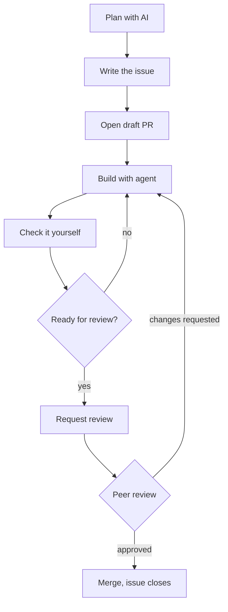

# AI-Assisted Project Workflow

Thanks to the rise in popularity and availability of AI coding agents, the role of a developer shifted from writing and producing code to planning and orchestrating agentic workflow. The goal of this assignment is to assist you in developing a modern workflow for your project development that reflects modern teamwork and best practices and that is suitable for agentic development

## Repo setup

To make any process meaningful it has to be **enforced**. When setting up your GitHub repo, these are the settings that **you are required** to set up
- Nobody can push directly to `main`
- Every PR needs at least one approval (review)
- Authors cannot approve their own PR

## Issue-driven development

You are going to use **GitHub Issues** to plan, scope and document the development of your project. A GitHub issue is a written description of one piece of work (a feature, a bug or a question) that the team can discuss, assign and track until it’s done.

When using agents to develop, issues give a clear, written goal and a definition of done to work toward, and they leave a record of what was asked, built and checked. Your second task will be to write **issue templates** that you will reuse throughout your project to describe and frame a feature, an experiment or a fix and define the required workload to be tackled by the agents.

### Issue templates types

As part of the repo, you and your group need to write **three different templates**: feature, experiment and chore.

| Type | Purpose | Example |
| --- | --- | --- |
| Feature | A planned code change or feature | Add a data loader for the training set |
| Experiment | Testing an idea with an unknown outcome | Impact of lowering learning rate on performance |
| Chore | A small fix that needs no planning | Fix a typo, update a library |

### Issue templates fields requirements

Each template **must include** a minimum set of fields, as illustrated in the following table. You are free to include additional fields if relevant.

| Field | Feature | Experiment | Chore |
| --- | --- | --- | --- |
| Goal: what should change | ✅ | ✅ | ✅ |
| Definition of done: how we check it works | ✅ |  | ✅ |
| Hypothesis: what you expect and why |  | ✅ |  |
| Plan: the steps | ✅ | ✅ |  |
| Out of scope: what not to touch | ✅ | ✅ |  |
| Planning model: tool and model used | ✅ | ✅ |  |
| Planning chat: link, or a summary of key prompts | ✅ | ✅ |  |
| Results: settings, numbers, conclusion |  | ✅ |  |

### Tips for scoping Issues

- **Make the definition of done concrete.** Not "improve the model", but "test accuracy above 85% with the current data". Agents work much better with a clear target!
- **Keep it small.** If the plan has more than a handful of steps, split it into several issues
- **Say what is out of scope.** Agents like to "help" by changing other files
- **Experiments can fail.** "It didn't work" is a valid result. Write down what you learned
- **Close the loop.** When an issue closes, add a comment: did the plan work? What would you scope differently?

## Pull requests

Each Issue can only be closed by an associated **Pull Request**: while the issue documents the plan and the scope of your changes, the PR records the actual changes to your codebase plus how they can be tested. To establish a strong workflow and empower AI agent use, you are tasked to write a **PR template** to use during development.

### PR template fields

| Field | Purpose |
| --- | --- |
| Linked issue | `Closes #<issue_number>` |
| Coding model | The agent and model used, e.g. "OpenCode with model X" |
| Agent session | A link, or a short summary of the key prompts |
| How to test | Steps the reviewer follows to check it works |
| Review checklist | (see "Reviews" section) |

### PR best practices

- **One issue, one PR**
- **Whoever opens the PR, owns the code.** You are responsible for the code you push
- **Keep it small:** under about 300 changed lines. Too big? Split the issue.
- **Credit the model in commits.** End each AI-assisted commit message with a line like `Co-authored-by: <model name> <email>`. GitHub shows it on the commit.

## Reviews

it is standard industry practice to have someone reviewing code changes before merges. Agents are known to confidently make mistakes so a good review process is a fundamental skill to develop!

The last field in the PR templates is a checklist left for the reviewer which itemizes the steps that need to be satisfied before merging the PR.

These are the **required fields** that you need to include in your PR template:

- [ ] I ran the code using the "How to test" steps.
- [ ] It meets the issue's definition of done.
- [ ] It only changes what the issue asked for.
- [ ] I understand what the code does.
- [ ] AI use is disclosed in the PR and commits.

### Reviewing best practices

- **Run it, don't just read it.** Follow the "How to test" steps yourself.
- **Check against the issue.** Does it meet the definition of done? Does it change only what was asked?
- **Ask, don't assume.** If something is unclear, ask in a comment. "Why this way?" is a good question.
- **Be specific.** Point to the line and say what to change. "Rename this to `train_loader`" beats "naming is off".
- **Be kind.** Review the code, not the person.
- **Watch for agent habits.** Look for unused code, made-up functions, and changes to unrelated files.
- **Disclose AI help.** Used AI to help review? Say so.
- **Don't rubber-stamp.** Only approve what you understand and would be happy to own.
- **Share the load.** Everyone in the group should review regularly.

## The workflow

This section summarizes and graphically represents the workflow you will need to follow.

| Step | Description |
| --- | --- |
| Plan with AI | Discuss the task with a planning agent. Ask the agent to generate a plan and review it |
| Write the issue | Ask agent to draft issue using the relevant template. Review and approve the issue before publishing it |
| Build with agent | From a new branch and fresh coding agent session, use the fully scoped issue to carry out the task. Ask the coding agent to plan first before generating code |
| Check it yourself | Run the code, read every change, remove out-of-scope changes |
| Open a PR | Fill in the PR template and link to issue (write `Closes #<issue number>`) |
| Peer review | A classmate reviews, approving or requesting changes |
| Merge | Summarize final outcome and close relevant issue |

## AI Tools

Whilst you are free to use any AI tool of your preference, you are recommended to distinguish between two types of agents and relative responsibilities: **planning** and **coding** agents

**Planning agents:**
- We will refer to planning agents to any chat-based assistants such as Claude, ChatGPT or Gemini
- They are useful for drafting ideas, understand concepts and discussing and drafting issues or PRs
- Such agents are very easy and quick to access and don't require much in terms of integration so they are perfect for canvassing and sparring
- Free-tier accounts are good enough for the above purposes

**Coding agents:**
- We will refer to coding agents as any tool that can read your project, edit files and run code for you, such as OpenCode, GitHub Copilot or Cursor
- They are specialized tools that can access, edit and run files from your files which tailors them for project-wide development (rather than ad-hoc code generation)
- They usually require some integration overhead which allows them to tap directly into the workflow by publishing and reading issues, pulling and pushing commits etc.
- Most of such tools are subscription-based or pay-per-usage. I recommend to look into **OpenCode** as a free alternative

### Coding agents and AGENTS.md

`AGENTS.md` is a file in your repo that tells agents how your project works. It contains a set of rules that the agent will always automatically load and they can include code philosophy, guidelines and other directions to be followed.

The file should include:

- What the project does, in a few sentences
- How folders are organized
- How to install, run and test the code
- Coding style and which libraries to use
- Rules, such as "never edit the data folder"

When an agent repeats a mistake, add a rule. Changes to `AGENTS.md` go through a PR like any other change.

### Best practices

**Working with planning agents**
- **Ask the agent to challenge your plan**, not simply agree with it
- **Give it context.** Paste your goal, your current code structure and any constraints. Vague input gets generic plans
- **Ask for options, not one answer.** "Give me two ways to do this and their trade-offs" teaches you more than a single plan
- **Make it ask you questions.** "What do you need to know before planning this?" exposes gaps in your thinking
- **Ask what could go wrong.** Include risks, edge cases and potential shortcomings in your plan
- **Keep it small.** If the plan has too many steps, discuss with the agent how to split it in smaller issues
- **Use it to learn.** Don't understand a term or concept in the plan? Ask to explain first, accept later
- **Check the facts.** Agents can invent functions, library features or numbers. Verify anything you'll rely on
- **The final decision is yours.** The agent suggests what to do but you own the final plan

**Working with coding agents**

- **Plan before code.** Fix the plan first. Fixing a plan is cheap; fixing code is not
- **One issue, one fresh session.** Long sessions get confused.
- **Be specific.** "Set batch size to 32 and log loss every epoch" beats "make it better"
- **Verify, don't trust.** Agents sound sure even when wrong. Always run your code
- **Understand before you submit.** Can't explain a line? Ask the agent, or rewrite it
- **Commit often.** Small commits are easy to undo
- **Save your limits.** Chat for questions, agents for coding

**Safety**

- **No API keys or passwords in the repo.** If one leaks, tell your teacher and replace it.
- **No personal or sensitive data in AI tools.** Many free tools train on what you type.
